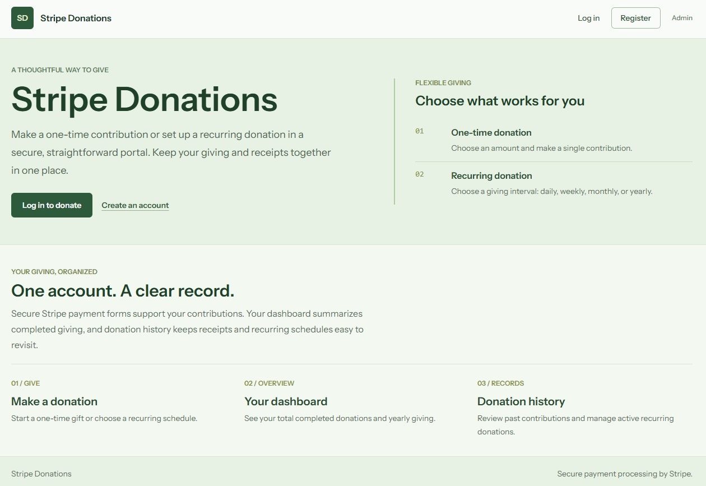
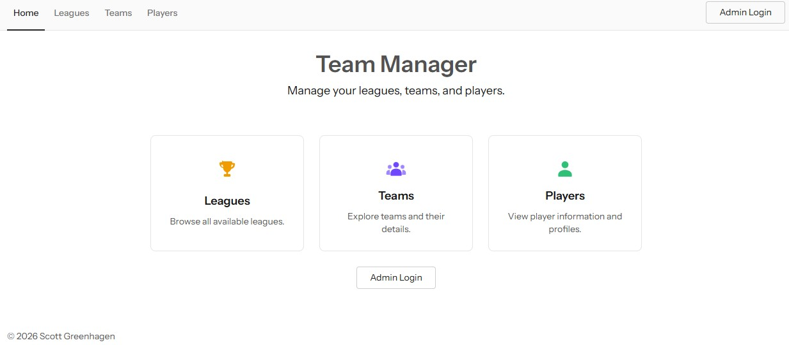

# S.G. Samples

> **Author:** Scott Greenhagen

Welcome! This repository is a collection of sample personal projects, built to demonstrate software engineering and technical development skills across a range of approaches — from vanilla, framework-free PHP to full-featured MVC frameworks like Laravel with Docker-based environments.

Each project lives in its own directory with a dedicated `README.md` covering setup, configuration, and usage instructions.

---

## Table of Contents

- [Laravel Stripe Donations](#laravel-stripe-donations)
- [Laravel Team Manager](#laravel-team-manager)
- [Vehicles OOP Demo](#vehicles-oop-demo)

<!--
- [CodeIgniter Team Manager](#codeigniter-team-manager)
-->

---

## [Laravel Stripe Donations](./laravel-stripe-donations)

A full-stack donations system, utilizing the Stripe API and payment gateway, built on the Laravel PHP framework with Cashier package using the modern TALL stack (Tailwind CSS, Alpine.js, Laravel, and Livewire).

Register for a new account, sign in to your existing account, and sign out of your account with the registration and login screens. After creating or signing in to a user account, you can make one-time or recurring donations using secure Stripe forms. Authenticated admin dashboard built with Filament for CRUD management of database records.

**Tech Stack:** PHP · MySQL · Laravel · Cashier · Stripe · Blade · Flux UI · Livewire · Filament · TypeScript/JavaScript · Alpine.js · Tailwind CSS · Vite · HTML5 · Docker · Composer · Pest

📄 [View project README](./laravel-stripe-donations/README.md)

---

## [Laravel Team Manager](./laravel-team-manager)

A full-stack relational management system built on the Laravel PHP framework for leagues, teams, and players using the modern TALL stack (Tailwind CSS, Alpine.js, Laravel, and Livewire).

Public visitors can browse a feature-rich frontend experience with Flux UI, Alpine.js, and Tailwind CSS in Blade templates for navigating leagues, teams, and players, including breadcrumb navigation through related records and layers. An authenticated admin dashboard built using Filament provides full CRUD management of database records.

**Tech Stack:** PHP · MySQL · Laravel · Blade · Flux UI · Livewire · Filament · TypeScript/JavaScript · Alpine.js · Tailwind CSS · Vite · HTML5 · Docker · Composer · Pest

📄 [View project README](./laravel-team-manager/README.md)

---

## [Vehicles OOP Demo](./vehicles-oop-demo)

A PHP command-line project that demonstrates core object-oriented programming concepts through a set of vehicle classes. I designed this project to help train junior developers in learning PHP.

Built with vanilla PHP — no framework — the project walks through encapsulation, inheritance, abstraction, and polymorphism using standard classes, an abstract class, an interface, a trait, an enum, and a static class.

**Tech Stack:** PHP · Docker · PHPUnit

📄 [View project README](./vehicles-oop-demo/README.md)

<!--
---

## [CodeIgniter Team Manager](./codeigniter-team-manager)

A web application built on the CodeIgniter PHP framework, designed to manage the organization of related leagues, teams, and players.

Includes public screens for browsing leagues, teams, and players, plus administrative screens for managing records — all backed by a relational MySQL database.

**Tech Stack:** PHP · CodeIgniter · MySQL · TypeScript/JavaScript · HTML5 · Docker · Composer · PHPUnit

📄 [View project README](./codeigniter-team-manager/README.md)
-->

---

## Copyright Information

Copyright Scott Greenhagen