# Laravel Stripe Donations

> **Author:** Scott Greenhagen

The **Laravel Stripe Donations** web application is a full-stack donations system, utilizing the Stripe API and payment gateway, built on the Laravel PHP framework with Cashier package using the modern TALL stack (Tailwind CSS, Alpine.js, Laravel, and Livewire).

---

## Table of Contents

- [Introduction](#introduction)
- [Description](#description)
- [Tech Stack](#tech-stack)
- [Laravel](#laravel)
- [Configuration and Setup](#configuration-and-setup)
- [Using the Application](#using-the-application)
- [Running Pest Test Suites](#running-pest-test-suites)
- [Copyright Information](#copyright-information)

---

## Introduction

This README contains a description of the **Stripe Donations** application and instructions for setup.
This application runs the bundled Laravel framework on PHP. 

---

## Description

**Donations** consist of 4 core models defined with Laravel's Eloquent ORM:

- User (user login authentication system)
- Donation (one-time or recurring)
- Subscription (Cashier model)
- Subscription Item (Cashier model)

### Public Screens

A public homepage with links in Blade templates that change dynamically based on whether the website visitor is a guest...


...or is currently signed in to a user account.

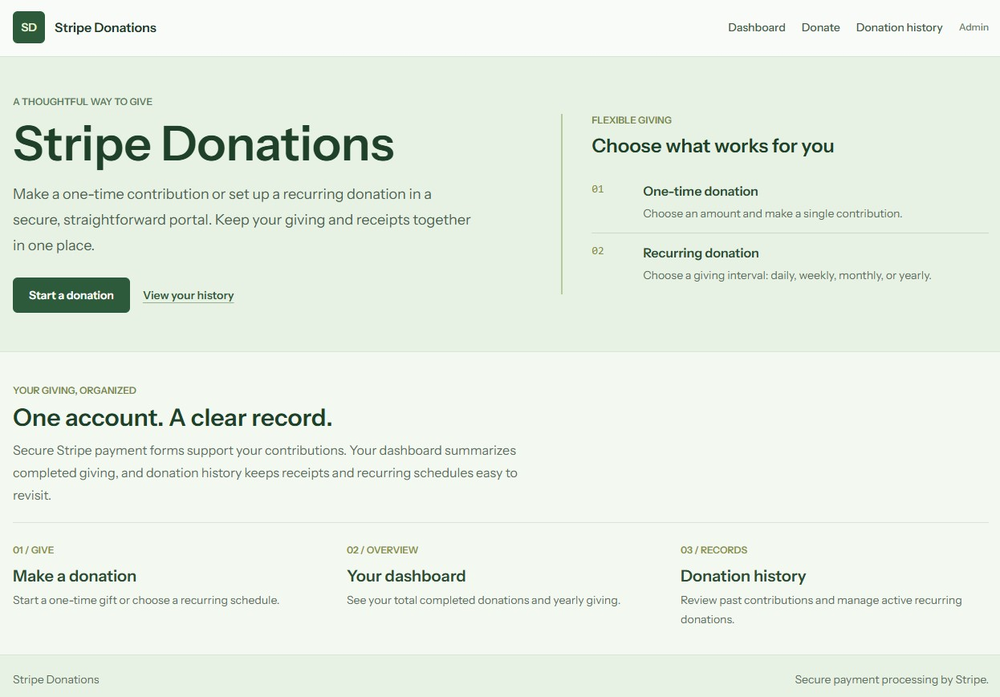

### Account Screens

Register for a new account, sign in to your existing account, and sign out of your account with the registration and login screens.

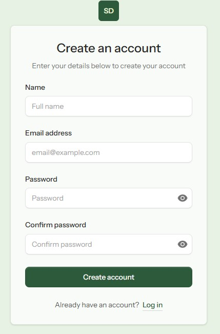
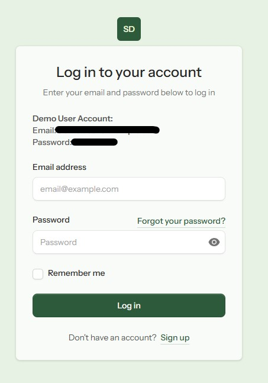

After signing in, authenticated account screens are available for the following using Flux UI, Alpine.js, and Tailwind CSS:

- A donation dashboard with summary statistics of completed donations
- A donation form to make a new one-time or recurring donation
- A donation history listing to view past donations and manage/cancel recurring donations
- An account settings area to manage/update user account settings

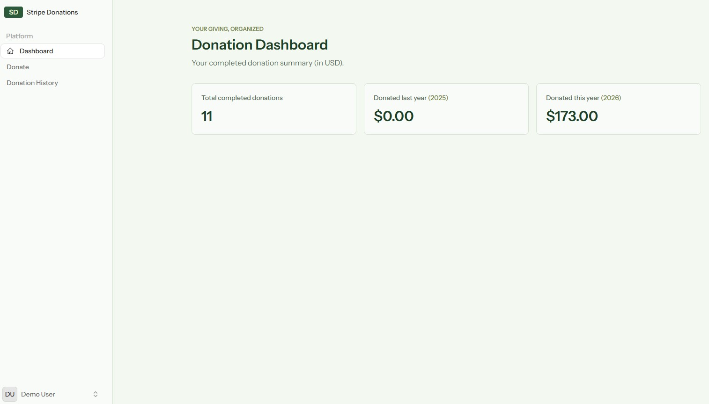

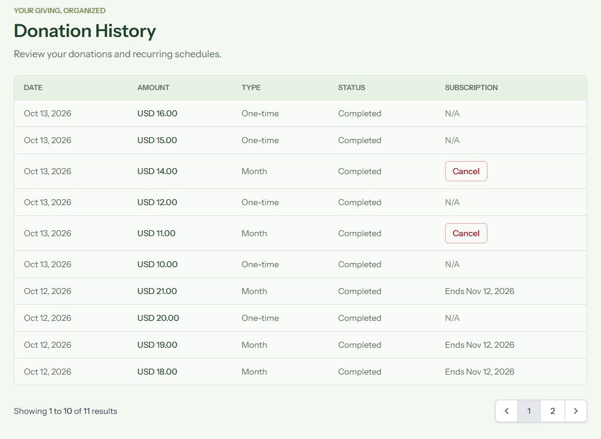

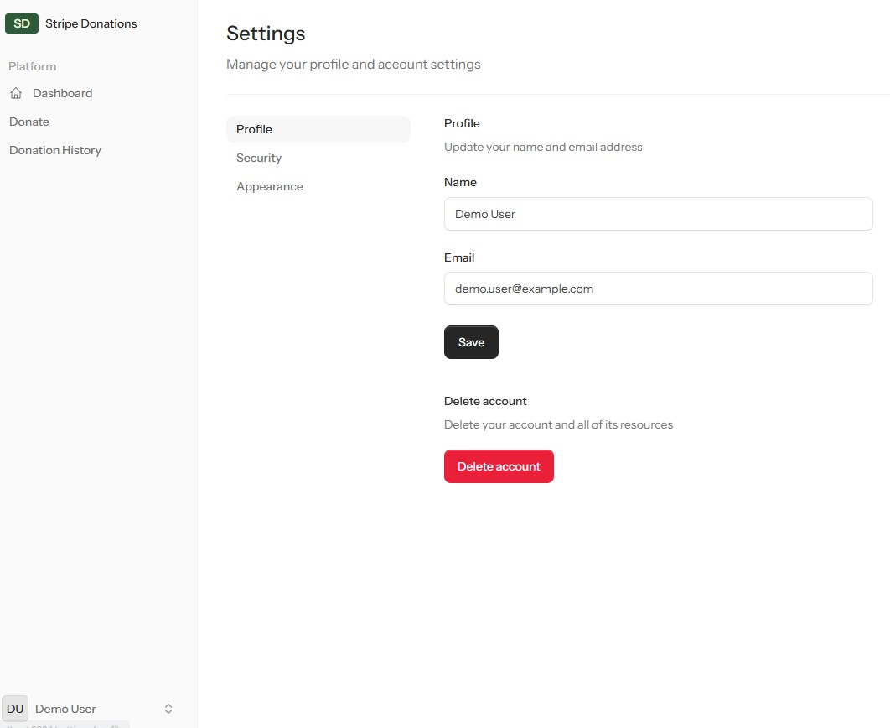

### Administrative Screens

Authenticated admin dashboard built with Filament for CRUD management of database records. User account records may be created/managed from here in addition to frontend registration. Donation records are mostly read-only for past payments, except that recurring donations may also be canceled. Log in to the administrative dashboard to access the system.

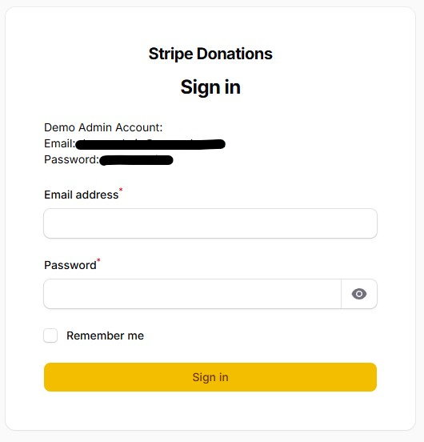

Administrative screens are available for the following:

- Create/manage user account records
- View/cancel one-time and recurring donations

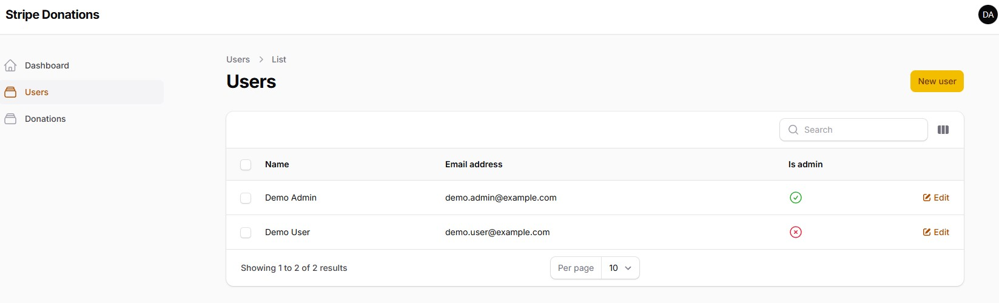
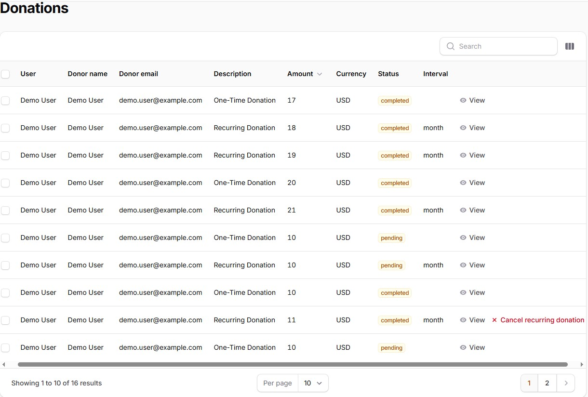

---

## Tech Stack

| Technology | Purpose |
|---|---|
| **PHP** | Foundational server-side scripting language |
| **MySQL** | Database |
| **Laravel** | Backend PHP framework |
| **Cashier** | Laravel package for Stripe payment processing |
| **Stripe** | Payment gateway and API |
| **Blade** | Frontend templating engine |
| **Flux UI** | System of UI components for Laravel Blade frontend |
| **Livewire** | Frontend framework for dynamic interfaces |
| **Filament** | Server-driven UI framework for admin panels |
| **TypeScript/JavaScript** | Frontend events |
| **Alpine.js** | Frontend JavaScript framework |
| **Tailwind CSS** | Utility-first CSS framework for frontend |
| **Vite** | Frontend build tool for JavaScript and CSS |
| **HTML5** | Frontend presentation |
| **Docker** | Local development environment |
| **Composer** | Dependency management |
| **Pest** | Automated testing suites |

---

## Laravel

The Stripe Donations application requires proper installation of the following:

- **PHP 8.4**
- **MySQL 8.0**
- **Laravel MVC Framework 13 (bundled)**

Docker files are available for PHP and MySQL. Laravel is available at no cost from the official website:

[Laravel](https://laravel.com/)

For more information on configuration settings for Laravel, see the Laravel user guide:

[Laravel User Guide](https://laravel.com/framework/docs)

---

## Configuration and Setup

### Development Environment

Docker files are available in the root directory to assist with setting up a runtime environment.
A `.env.example` file is provided for setting environment variables. Copy it as `.env`:

```bash
cd laravel-stripe-donations
cp .env.example .env
```

Then fill in the blanks in your new .env file. 

**Composer** is used as the dependency manager. From the `laravel-stripe-donations` directory, 
run composer install to retrieve dependencies:

```bash
composer install
```

From the `laravel-stripe-donations` directory, run the Docker build step:

```bash
docker compose up --build -d
```

From the `laravel-stripe-donations` directory, run this command to generate a new APP_KEY for your .env file:

```bash
docker compose exec server php artisan key:generate
```

### Database

The Stripe Donations application utilizes a relational **MySQL** database to store records.
Configure your database connection parameters in the .env file you copied above.

### Database Setup

Automated database migration scripts are provided for easy database setup. 
From the `laravel-stripe-donations` directory, run Laravel database migrations to 
migrate starter table structures through Docker server:

```bash
docker compose exec server php artisan migrate
```

Seed the database with sample data, using provided database seeder and factories:

```bash
docker compose exec server php artisan db:seed
```

The Stripe Donations app should then be available at http://localhost:9004/ in your web browser.

---

## Using the Application

From the homepage, you can select from the following screens:

1. **Register**
2. **Log in**
3. **Admin**

### Navigation

Global navigation is provided at the top. Click the **Home** navigation link at the top left to return to the homepage. Click the **Admin** button at the top right to access the admin dashboard management area.

### Account Screens

The following demo user account is provided for easy sign in, or you may register for your own account...
- Email: demo.user@example.com
- Password: demouser

After creating or signing in to your user account as described above, you can make one-time or recurring donations using secure Stripe forms:

- On the donate form, select your desired donation amount and donation type (one-time or recurring).
- If recurring, select your desired schedule (daily, weekly, monthly, yearly).
- Click the donate button to continue to a secure Stripe form where you will enter your payment information.
- After completing all required payment fields, submit the form to process your donation.
- A payment receipt will be displayed with the details of your successful payment.
- View your donation history to see past donations and manage/cancel recurring donations.
- Access your account settings area to manage/update your profile information or account password.
- A sidebar navigation is present all on account pages for easy access to other pages.

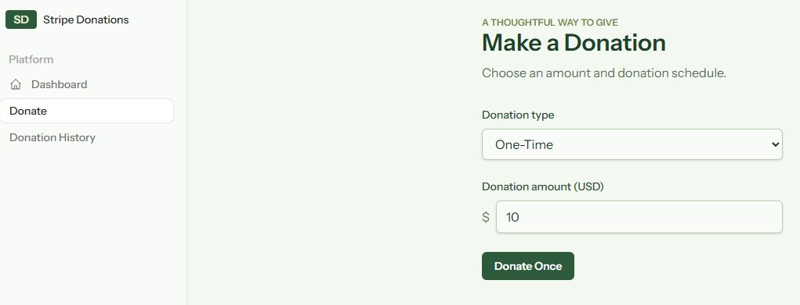
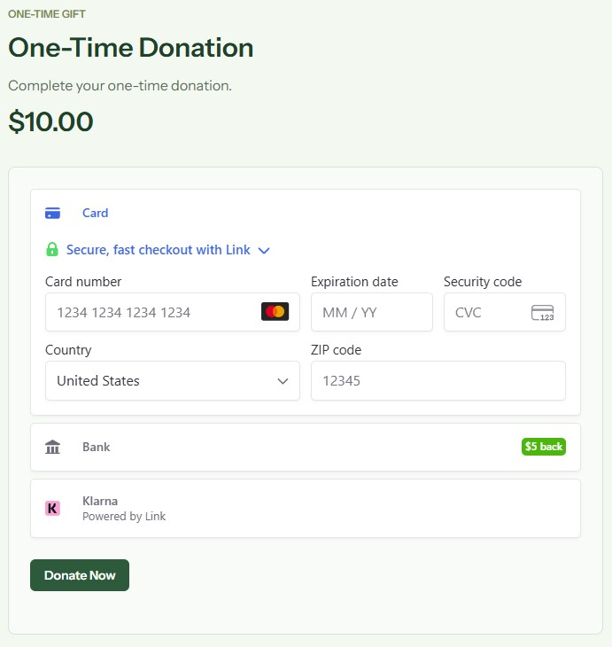
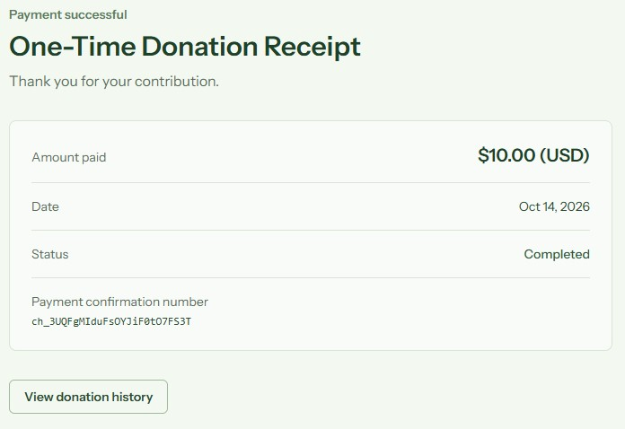

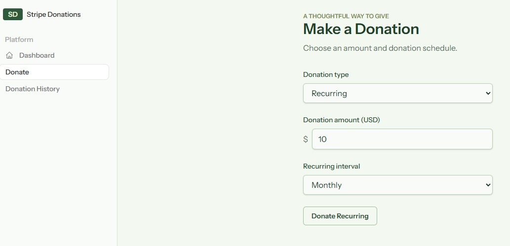
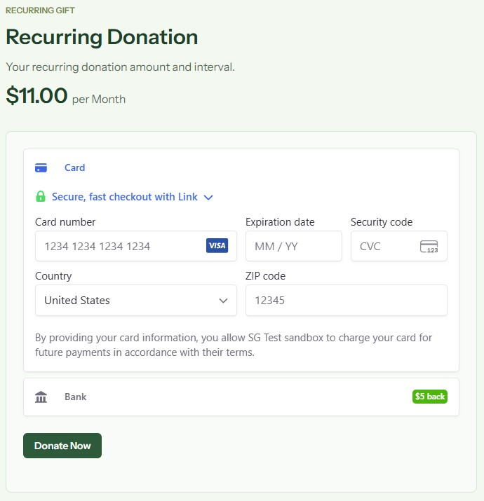
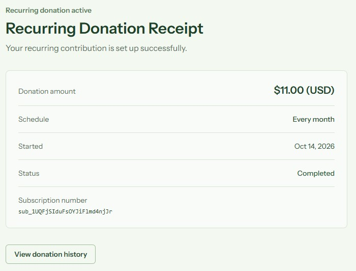

### Administrative Management

Sign in to the administrative dashboard with the following provided demo admin user account credentials...
- Email: demo.admin@example.com
- Password: demoadmin

On the admin screens:

1. **Manage Users**
2. **View/Cancel Donations**

The administrative management pages provide the following options for user accounts:

1. **Add New User**
2. **Edit User**
3. **Delete User**

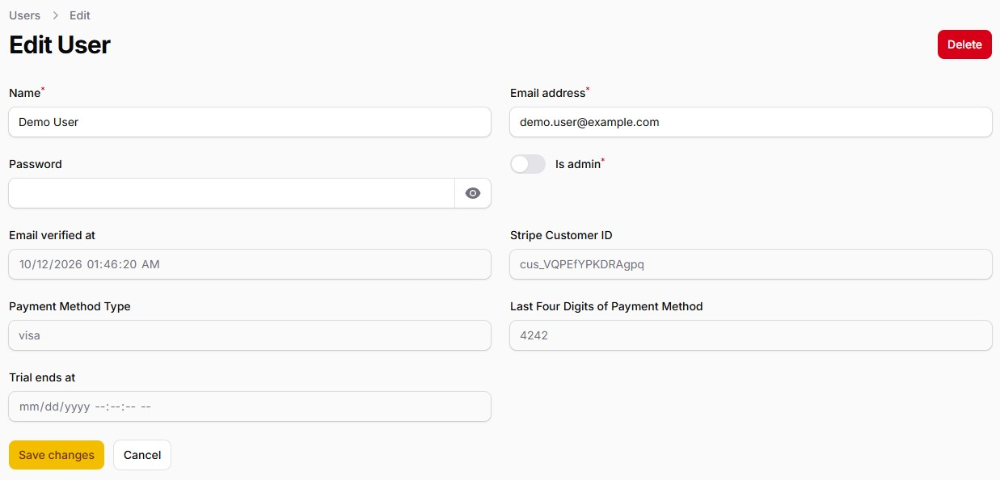
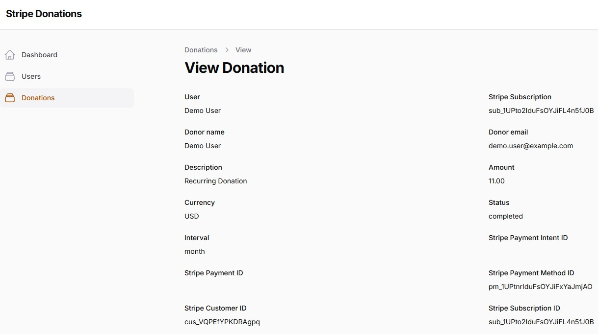

---

## Running Pest Test Suites

The included Pest test suites are located in the `tests` directory.

From the `laravel-stripe-donations` directory, run all available tests via Laravel Artisan console command:

```bash
docker compose exec server php artisan test
```

Alternatively, run the following Pest tests directly through Docker:

```bash
docker compose exec server ./vendor/bin/pest
```

### Code Coverage

The provided Docker configuration also includes the **PCOV** code coverage client.

Run all tests and display the PCOV coverage report:

```bash
docker compose exec server php artisan test --coverage
```

### Refreshing the Database after Testing

At the conclusion of testing, you may wish to refresh the database and roll back to its original state. 
From the `laravel-stripe-donations` directory, this command will rerun all database seeds and factories 
to repopulate the migration database tables:

```bash
docker compose exec server php artisan migrate:refresh --seed
```

---

## Copyright Information

Copyright 2026 (built with Laravel 13)  

**Scott Greenhagen**